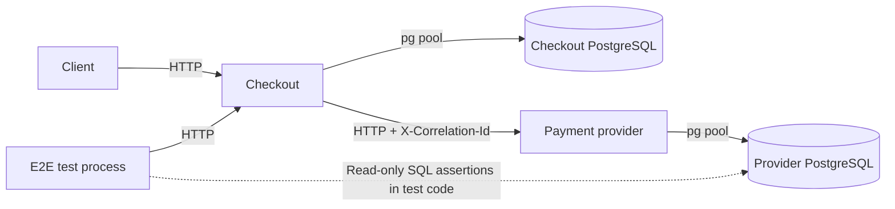

# Architecture

FaultLab's first version demonstrates the boundary between an order database and
an independent fictitious payment provider. It is not a fault-injection engine.

## Ownership and modules

- Checkout owns orders. Its orders module separates controller/DTO validation,
  service use cases and a parameterized pg repository.
- The provider owns charges. Its charges module has the same layers and always
  creates a new SUCCEEDED fictitious charge for a valid request.
- PaymentGateway is checkout's port for creating a charge. PAYMENT_GATEWAY and
  PAYMENT_HTTP_CLIENT are injection tokens; HttpPaymentGateway implements the
  HTTP contract without importing provider source or accessing provider SQL.
- Each service owns environment validation, a connection pool, migrations,
  observability, its bootstrap and its Dockerfile.
- packages/core, packages/cli and scenarios remain reserved. tests/e2e is a real
  workspace package containing test infrastructure only.

The two PostgreSQL instances have independent databases, roles, processes and
data volumes. merchantReference is an external UUID, not a foreign key and not a
unique key. The provider does not query checkout to verify it. Direct provider
SQL access from the E2E test is an assertion mechanism, not an application path.

## Payment flow

1. Checkout reads the persisted order. Missing orders return 404.
2. If PAID, it returns the stored state without another provider call or update.
3. If pending, it POSTs the persisted ID, amount and currency to /charges.
4. It validates HTTP 201, JSON, a charge UUID, matching reference/amount/currency,
   SUCCEEDED status and a valid timestamp under a finite HTTP deadline.
5. After a valid confirmation, one SQL UPDATE writes PAID, providerChargeId and
   updatedAt atomically, leaving amount, currency and createdAt unchanged.
6. The updated row is returned only after that SQL operation completes.

No PostgreSQL transaction spans the HTTP operation. No application retries or
redirect following are enabled. A failed provider exchange does not update the
pending order. A local SQL statement failure rolls back its update atomically.

These statements do not guarantee one charge under every failure. A provider can
commit before its response is lost. A database can also commit before an
acknowledgement is lost. A retry by a caller can create another charge. Two
concurrent pending-order requests can charge twice; the last local update can
retain only one charge ID. There is no distributed idempotency, distributed
transaction, compensation or automatic reconciliation in this version.

## Runtime topology and lifecycle

Development compose.yaml defines a private database network per service and a
payments network containing only the application containers. It publishes APIs
and databases on loopback. Only the relevant PG credentials reach each app.
Checkout addresses the provider by service DNS, not a shared database connection.

Dockerfiles use build/runtime stages and an unprivileged runtime user. PostgreSQL
development volumes persist across normal shutdown. Migrations are explicit
commands and have per-database history and advisory locking. Their initial
schema migrations and table migrations are reversible; reverting table creation
discards the table's data. Migrations never run implicitly at application startup.

GET /health checks the process; GET /health/ready checks that service's own database
identity. Checkout readiness does not require the provider to be available.
Connection and query timeouts are finite. Idle connection errors are handled;
shutdown hooks call pool.end(). Compose allows ten seconds for graceful shutdown.

## Error and correlation boundary

Both services use a global filter with the same public error envelope. Only
allowlisted public messages/codes reach clients; raw errors, SQL, credentials
and stacks are excluded. Existing HTTP status semantics are preserved.

Early middleware validates or generates X-Correlation-Id before body parsing,
puts it in AsyncLocalStorage.run, adds the response header, and records request
start/completion. The checkout adapter forwards it to the provider. Concurrent
requests have separate contexts; completion callbacks capture their own ID.

JSON logs contain service, time, event, level and correlationId. Request metadata
uses fixed route templates rather than URLs or query strings. Bodies, cookies,
authorization and exception arguments are not serialized. Background events use
null correlation instead of a stale request ID. See the HTTP reference for rules.

## E2E design and isolation

tests/e2e starts both real application images over HTTP and two real PostgreSQL
instances through its own compose.yaml. A cryptographically random project name,
random loopback ports, fixed test-only credentials and tmpfs storage separate
each run from development data and parallel runs. An explicit empty env example
prevents loading the development .env. A safety check rejects persistent/host
mounts, external networks and resource names outside the generated project.

The runner builds the images, applies real migrations and checks readiness with
deadlines. HTTP polling checks the actual condition, using bounded backoff only
after a failed probe. There are no unconditional startup sleeps. Compose health
waiting is capped at 120 seconds, HTTP readiness at 30 seconds per service,
provider shutdown readiness at 15 seconds, commands at five minutes, individual
test processes at two minutes, and the whole run at ten minutes.

The primary test queries provider PostgreSQL from test code to establish exactly
one charge for that order and verify ID, amount, currency and status. It repeats
payment sequentially, verifies the count again, then tests logs for supplied and
generated correlation IDs. A separate phase stops the provider application while
its database remains running; checkout must preserve a new pending order and
return a controlled 503/504 without a provider charge.

Each node:test module runs directly in one owned child process, avoiding forked
test-worker grandchildren. Commands are spawned without shells and awaited until
close. Deadlines/cancellation terminate owned process trees (process groups on
Linux, taskkill /T on Windows) and reap direct children, including commands that
launch a Compose plugin. Finally cleanup
uses an independent deadline and runs even after assertion failure, timeout or
handled SIGINT/SIGTERM. It removes only the validated random Compose project and
verifies no owned containers remain. No DELETE/TRUNCATE is issued against any
database and no global Docker prune is used. SIGKILL, host loss or unavailable
Docker can prevent cleanup; artifacts include the project ID for diagnosis.

Diagnostics under tests/e2e/artifacts/<project>/ include JSON application logs and
correlation receipts. They are Git-ignored. Image/build caches are retained.

## Continuous integration

The CI workflow uses GitHub-hosted Ubuntu, Node.js 24, pinned pnpm 10.33.0 and
commit-pinned actions. Installation uses the committed lockfile. Checks execute
formatting, lint, strict types, workspace build, unit/component/harness tests,
both isolated PostgreSQL suites and E2E. Diagnostics are uploaded even on failure.
No development secrets or external provider account is required.

The workflow definition is not itself evidence of a successful execution. Check
the run for the exact commit on GitHub Actions; local validation and hosted CI
results are distinct.

## Optional response-loss proxy

The optional [fault proxy](fault-proxy.md) can be inserted through checkout's
existing gateway URL. It uses Node.js HTTP/HTTPS in an independent workspace
package with no database access. It receives a complete provider 201 response
before consuming one in-memory fault and closing the caller connection without
delivering that confirmation. The default direct path and payment rules remain
unchanged. This is a manually armed transport experiment, not the future engine.

## Deferred scope

There is no authentication/authorization, real money movement, distributed
idempotency, concurrency-safe payment protocol, automatic reconciliation,
production secret/role management, fault engine, scenario runner or CLI. Those
are not implied by a passing sequential happy-path E2E test.
